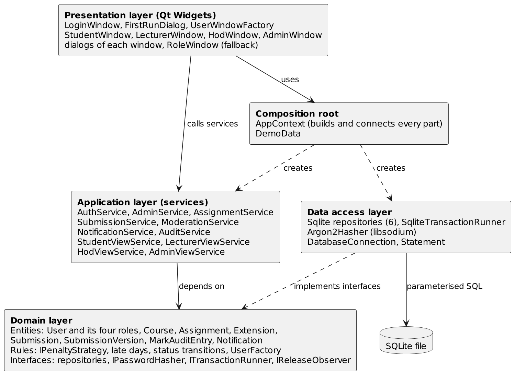

<div align="center">

# 🎓 MODERATED LMS

### A Software Engineering Project

**An offline desktop Learning Management System with secure assessment moderation, role-based access control and automated testing.**


**489 Automated Tests Passed · 98% Recorded Business Logic Coverage · Windows Release v1.1**

[**Download v1.1**](https://github.com/lephahamelamatsoso08-glitch/lms/releases/tag/v1.1) |
[**Final Report**](docs/Final_Report.pdf) |
[**UML Diagrams**](docs/diagrams) |
[**Test Evidence**](docs/evidence)

</div>

---

## 📖 Project Overview

The **Moderated Learning Management System (LMS)** is a C++ desktop application developed as an individual Software Engineering project for **CS4433 at the National University of Lesotho**.

It supports course administration, assignment management, student submissions, assessment marking and departmental moderation.

The central business rule is that **assessment results remain hidden from students until they are reviewed and released by the Head of Department**.

The project demonstrates practical Software Engineering concepts, including:

- Requirements engineering and traceability
- Layered architecture and separation of concerns
- Object-oriented programming and SOLID principles
- Repository and Strategy design patterns
- Automated unit, integration and regression testing
- Software configuration management and Continuous Integration
- Software deployment and perfective maintenance

---

## ✨ Features

| User role | Main functionality |
|---|---|
| 👨‍💼 **Administrator** | Manage users, departments, courses, lecturers and enrolments |
| 👨‍🏫 **Lecturer** | Create assignments, extend deadlines, review submissions, mark work and provide feedback |
| 🏛️ **Head of Department** | Moderate assessments, approve or adjust marks, release results and review audit history |
| 🎓 **Student** | View enrolled courses, submit assignments, resubmit work and view released results |

### Important Business Rules

- Late submissions are accepted with a penalty of **10% of the maximum mark per late day**, up to three days.
- Students may resubmit work within the applicable deadline.
- Previous submission versions are retained.
- Marks are hidden until officially released.
- Mark changes are recorded in an audit trail.
- Lecturers can grant individual or class-wide deadline extensions.
- The application operates offline using SQLite.

---

## 🏗️ Software Architecture

The application follows a layered architecture with clear separation of responsibilities.

| Layer | Responsibilities | Source |
|---|---|---|
| Presentation | Qt windows, dialogs and user interaction | `src/ui/` |
| Application | Use-case orchestration and access control | `src/application/` |
| Domain | Business entities, rules and repository interfaces | `src/domain/` |
| Data Access | SQLite repositories, transactions and hashing | `src/data/` |
| Composition Root | Application configuration and dependency wiring | `src/app/` |

### Engineering Principles

**Single Responsibility Principle**

Services have focused responsibilities, such as authentication, assignment management and moderation.

**Dependency Inversion Principle**

Application services depend on domain repository interfaces rather than concrete SQLite implementations.

**Repository Pattern**

Persistence operations are abstracted behind interfaces, helping isolate database concerns from business logic.

**Strategy Pattern**

The late-submission penalty is implemented through a dedicated strategy abstraction.

**Separation of Concerns**

Business rules are kept independent of the Qt user interface and SQL implementation.

### Architecture Diagram

[](docs/diagrams/03-component-architecture.png)

Explore the complete [UML and database diagrams](docs/diagrams).

---

## 🧪 Testing and Quality Assurance

### Automated Test Results

| Metric | Recorded result |
|---|---|
| Automated regression tests | **489 / 489 passed** |
| Failed tests | **0** |
| Total execution time | **139.96 seconds** |
| Recorded domain/application line coverage | **98% (960/980 lines)** |
| Functions analysed | **415** |
| Average cyclomatic complexity | **2.3** |
| Functions exceeding configured complexity threshold | **0** |

**Coverage note:** The recorded 98% coverage result predates the v1.1 maintenance changes and should not be interpreted as a complete v1.1 coverage measurement.

### Quality Tools

- **GoogleTest:** Automated tests
- **CTest:** Test execution
- **gcovr:** Code coverage reporting
- **cppcheck:** Static analysis
- **clang-tidy:** C++ static analysis
- **Lizard:** Complexity metrics
- **GitHub Actions:** Automated builds and tests

### Evidence

- [Automated test results](docs/evidence/test-results.txt)
- [Coverage report](docs/evidence/coverage.txt)
- [Code complexity metrics](docs/evidence/metrics.txt)
- [Static analysis reports](docs/evidence)

Run the tests locally:

```bash
cmake --build build
ctest --test-dir build --output-on-failure
```

---

## 💻 Installation and Demonstration

### Download the Windows Application

Download the packaged version from:

### [📦 Moderated LMS v1.1 — Windows Release](https://github.com/lephahamelamatsoso08-glitch/lms/releases/tag/v1.1)

1. Download `lms-windows-v1.1.zip`.
2. Extract the ZIP file.
3. Open the extracted application folder.
4. Run `start_demo.bat` for demonstration mode.

The Windows distribution includes the application executable and its required runtime libraries.

**Note:** Portability on an independent Windows computer without the development environment has not been separately verified.

### Build from Source

The project uses **CMake and Ninja**. See [BUILDING.md](BUILDING.md) for prerequisites and detailed build instructions.

For an existing configured build:

```bash
cmake --build build
ctest --test-dir build --output-on-failure
```

To launch the application with demonstration data:

```bash
./build/src/ui/lms.exe --db demo.db --demo
```

### Demo Accounts

| Role | Username |
|---|---|
| Administrator | `admin` |
| Lecturer | `lecturer1` |
| Head of Department | `hod1` |
| Student | `student1` |
| Student | `student2` |

Demo password: `Passw0rd1`

> Demonstration accounts are intended for testing only. Real deployments must use unique, secure credentials.

---

## 🔄 Software Maintenance — Release v1.1

Version **1.1** introduces **class-wide assignment deadline extensions**.

### Change Request CR1

**Requirement:** A lecturer must be able to extend an assignment deadline for an entire class, and affected students must see their updated deadlines.

### Engineering Approach

1. Analysed the impact on assignment services, data access and user interfaces.
2. Implemented the feature on `feature/class-wide-extensions`.
3. Reused existing enrolment and extension functionality.
4. Integrated database transaction support.
5. Added four automated regression tests.
6. Executed the complete suite: **489/489 tests passed**.
7. Verified the lecturer interface and the updated student deadline.
8. Merged the changes into `main` and published `v1.1`.

**Maintenance classification:** Perfective maintenance.

[Read the CR1 impact analysis](docs/maintenance/CR1_CLASS_WIDE_EXTENSIONS.md)

---

## 📚 Documentation

| Document | Description |
|---|---|
| [Final Software Engineering Report](docs/Final_Report.pdf) | Five-page academic report with diagram hyperlinks |
| [UML Diagrams](docs/diagrams) | Planning, requirements, architecture, sequence, state and ER diagrams |
| [Installation Guide](docs/deployment/INSTALLATION_GUIDE.md) | Windows installation and deployment |
| [Administrator Manual](docs/deployment/ADMIN_MANUAL.md) | Administration workflow |
| [Lecturer Manual](docs/deployment/LECTURER_MANUAL.md) | Assignment and marking workflow |
| [Head of Department Manual](docs/deployment/HOD_MANUAL.md) | Assessment moderation |
| [Student Manual](docs/deployment/STUDENT_MANUAL.md) | Student workflow |
| [Branching Strategy](docs/BRANCHING.md) | Version control and configuration management |
| [CR1 Maintenance Report](docs/maintenance/CR1_CLASS_WIDE_EXTENSIONS.md) | Maintenance impact and verification |

---

## 🛠️ Technology Stack

| Category | Technologies |
|---|---|
| Programming language | C++17 |
| Desktop interface | Qt 6 Widgets |
| Database | SQLite |
| Password hashing | libsodium / Argon2id |
| Build system | CMake, Ninja |
| Testing | GoogleTest, CTest |
| Quality analysis | gcovr, cppcheck, clang-tidy, Lizard |
| Version control | Git and GitHub |
| Automation | GitHub Actions |

---

## 🚀 Future Improvements

- Shared multi-user deployment using a server architecture
- Improved portability testing across Windows installations
- More robust management of submitted files
- Expanded acceptance and security testing
- Enhanced reporting and administrative dashboards

---

## 👨‍💻 Project Information

**Project:** Moderated Learning Management System

**Course:** CS4433 Software Engineering

**Institution:** National University of Lesotho

**Development:** Individual academic project

**Current release:** [v1.1](https://github.com/lephahamelamatsoso08-glitch/lms/releases/tag/v1.1)

---

<div align="center">

**Designed, implemented, tested and maintained using Software Engineering principles.**

</div>
